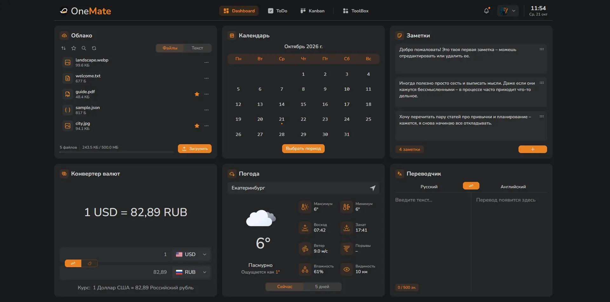
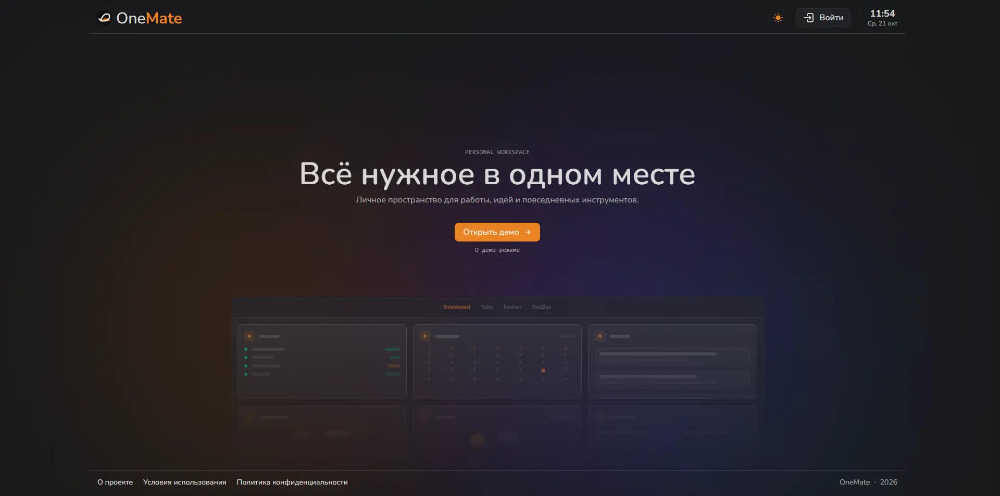
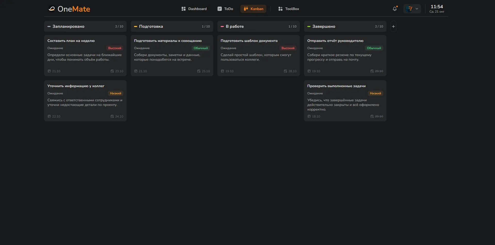

# OneMate – твоё личное рабочее пространство

**OneMate** – веб-приложение для организации личного рабочего пространства с настраиваемым рабочим столом, управлением задачами и инструментами для повседневной работы.

  

  

## Модули

### Dashboard

**Настраиваемый рабочий стол** с шестью виджетами на выбор. Поддерживает добавление инструментов из каталога и изменение их расположения с помощью drag & drop.

Доступные виджеты:

- **Облако** – хранение и предпросмотр файлов, публичные ссылки и облачный буфер обмена;
- **Заметки** – создание, редактирование и сортировка заметок;
- **Календарь** – выбор периодов, подсчёт дней и копирование результатов;
- **Калькулятор** – арифметические операции и история вычислений;
- **Конвертер валют** – конвертация сумм и копирование курсов и результатов;
- **Погода** – текущие погодные условия и прогноз до 5 дней;
- **Сеть** – мониторинг доступности сайтов и серверов с уведомлениями;
- **Переводчик** – перевод текста между языками.

### Kanban

**Интерактивная доска** для планирования и управления задачами, позволяющая организовывать рабочие процессы с помощью настраиваемых колонок, приоритетов и сроков выполнения.

- создание и настройка задач и колонок;
- сортировка и перемещение с помощью drag & drop;
- управление приоритетами, статусами и сроками выполнения;
- уведомления о просроченных задачах.

### ToDo

Раздел для управления списками дел – **в разработке**.

## Технологический стек

### Frontend

- **React** и **TypeScript** – компонентная архитектура и строгая типизация;
- **FSD (Feature-Sliced Design)** – четкое разделение ответственности и масштабируемая структура;
- **Tailwind CSS** – единый визуальный стиль и быстрая адаптивная вёрстка;
- **MobX** – реактивное управление состоянием с лаконичным синтаксисом;
- **Vite** – быстрый запуск и оптимизированная сборка.

### Backend

- **Laravel** и **Sanctum** – серверная бизнес-логика, REST API и сессионная аутентификация;
- **PostgreSQL** – реляционное хранение данных и управление связями между сущностями;
- **Redis** – хранение сессий и обеспечение работы фоновых очередей;
- **Laravel Queues** и **Scheduler** – асинхронное выполнение задач и автоматизация периодических процессов;
- **Laravel Notifications** – централизованная система уведомлений о событиях приложения.

### DevOps & Infrastructure

- **Docker** и **Docker Compose** – контейнеризация приложений и унификация окружения;
- **Nginx** – reverse proxy и раздача приложений;
- **VPS** – деплой и администрирование проекта.

## Возможности

- **Авторизация** – регистрация по приглашению, вход по email и восстановление пароля;
- **Учётная запись** – управление профилем, смена пароля, активные сессии и история входов;
- **Интерфейс** – адаптивная вёрстка для всех устройств, светлая и тёмная темы;
- **Уведомления** – единый центр событий приложения;
- **Демо-режим** – знакомство с возможностями без регистрации.

## Скриншоты

Показать

  
  
  

## Автор

 
